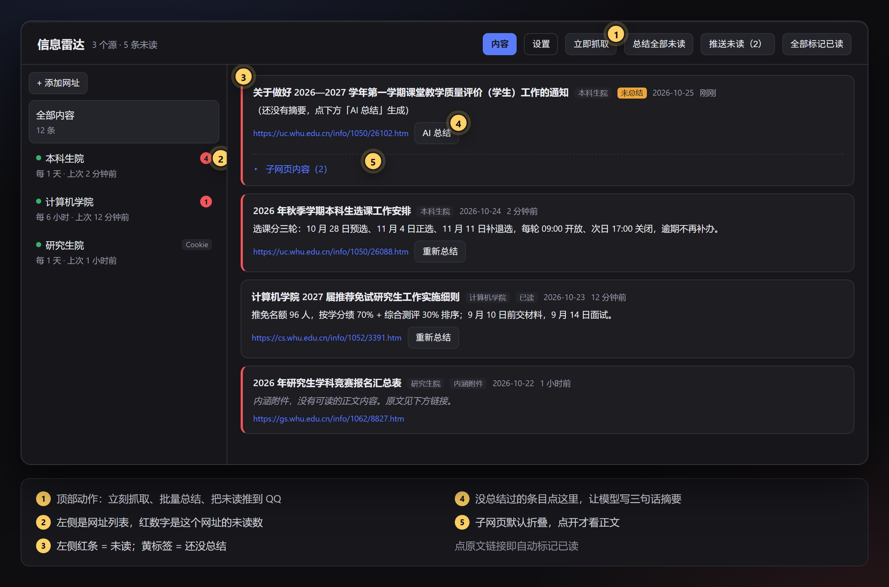
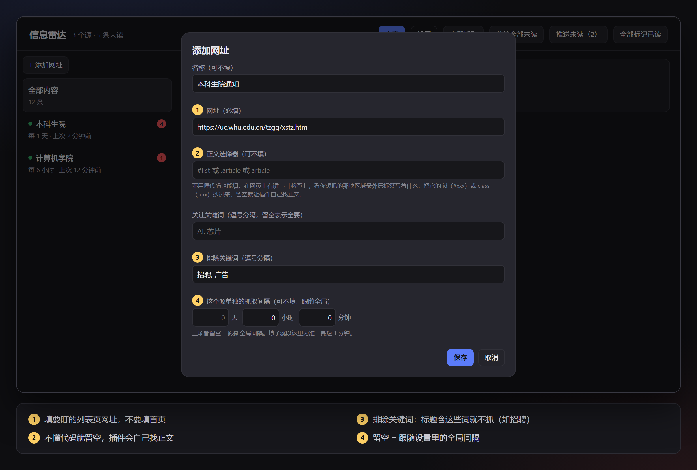
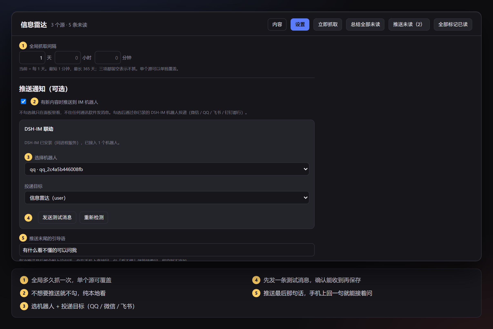
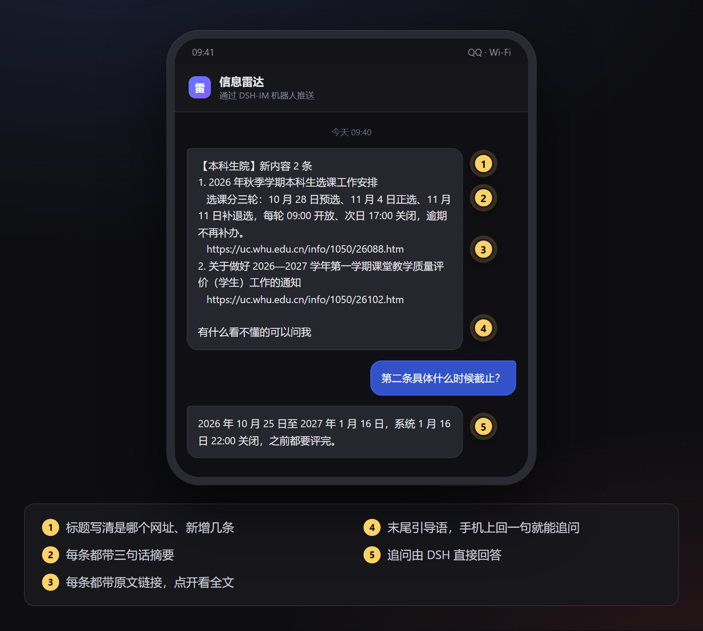

<div align="center">


# 信息雷达 · dsh-info-radar

**把你关心的网页变成一条时间线：只告诉你「今天新增了什么」，顺手让 DeepSeek 写成三句话。**

[](LICENSE)


</div>

---

### 👋 先说一句

> **如果这个插件帮你少刷了几次教务处 / 学院 / 公司内网，点个 ⭐ Star 就是最实在的支持。**
>
> 它是被「通知发了三天我才知道」逼出来的：每天手动翻十个网站，翻完还漏。
> 现在把网址丢进去，剩下的交给它。
>
> **用着有问题、想要新功能、或者只是想说一句「装上了」，都欢迎 [开一个 Issue](https://github.com/JJhaojie/dsh-information-radar/issues/new)。**
> 我会把真实的抓取场景排进下一版——被最多人需要的那个，先做。



<p align="center"><sub>面板长这样：左边是网址，右边是新增内容，红条是未读，黄标是「还没总结」。</sub></p>

---

## 它解决什么问题

学校教务处的通知、学院的评奖评优、研究生院的报名截止、公司内网的公告……
这些页面**没有 RSS，也没有推送，只能靠你每天手动刷新**。

信息雷达做的事很简单：

1. 你给它一个网址，它按你定的间隔去翻；
2. 第一次翻只记住「现在有什么」，**不打扰你**；
3. 之后页面上**新出现**的内容，才会进入你的列表；
4. 你点一下「AI 总结」，DeepSeek 把一篇通知压成三句话；
5. 想更省事，就把摘要推到 QQ / 微信 / 飞书，在手机上看。

## 功能一览

| 能力 | 说明 |
| --- | --- |
| ⏱ 定时抓取 | 全局间隔 + 每个网址可单独覆盖，最短 1 分钟、最长 365 天 |
| 🆕 只收新增 | 首次抓取建立「基线」，之后只有真正的新条目才入库，不会一上来淹你 |
| 📄 列表 → 详情 → 子页 | 从列表页抽条目链接，进详情页取正文；正文里挂的子网页、附件表也能识别 |
| 🤖 AI 摘要 | 单条总结 / 一键总结全部未读（最多 50 条），失败会写明原因，不会假装成功 |
| 🔴 未读红点 | 侧栏图标、每个网址后面都有未读数；点开原文即已读 |
| 📲 推送 IM | 通过 DSH-IM 推到 QQ / 微信 / 飞书 / 钉钉，一个源一条消息、最多展开 20 条，带摘要和链接 |
| 🍪 需要登录的站 | 支持 Cookie / User-Agent / Referer，掉登录态会在右下角提醒你 |
| 🧹 自动清理 | 可选定期删除已读内容，未读永远保留 |

---

## 安装

### 你需要

- **DeepSeek Harness 0.2.x**（桌面端实测通过；Web 端用的是同一套客户端槽位，但没实测）
- 一个能敲命令的 DSH 内置终端
- 可选：要推送的话再装 [DSH-IM](#可选推送功能需要-dsh-im)

> ⚠️ 本插件只在你自己的机器上跑：数据存在本地，不发往任何第三方服务（除了你自己配置的模型）。

### 方式一：把这段提示词丢给你的 DSH（推荐，小白友好）

复制下面整段，粘贴到 DSH 的输入框发送：

```text
帮我安装 dsh-info-radar 插件（一个给 DeepSeek Harness 用的网页更新监控插件）。

仓库：https://github.com/JJhaojie/dsh-information-radar

请按顺序做，每步都告诉我结果：
1. 确认我当前使用的 profile 名。桌面端一般是 desktop：跑 dsh plugin --profile desktop list 能成功就说明名字对。
2. 把仓库 clone 到一个固定目录，路径不要带空格：
   - Windows：E:\dsh-plugins\dsh-information-radar
   - macOS / Linux：~/dsh-plugins/dsh-information-radar
3. 执行：dsh plugin --profile <profile> add -w <clone 目录的绝对路径>
4. 告诉我需要完全退出 DSH（托盘图标也要退出）再重新打开。
5. 重启后如果左侧栏没有「信息雷达」，把终端完整报错贴给你，由你判断是 profile 名、路径还是包结构的问题。

装好之前先别改我的配置，装完等我确认。
```

### 方式二：自己敲命令

```bash
# 1. 克隆到任意目录（路径不带空格最省事）
git clone https://github.com/JJhaojie/dsh-information-radar.git

# 2. 装进你的 profile（desktop 换成你自己的 profile 名：desktop / web / tui）
dsh plugin --profile desktop add -w "dsh-information-radar的绝对路径"

# 3. 完全退出 DSH（托盘图标也要退出），再打开
```

Windows PowerShell 里第二步写成：

```powershell
dsh plugin --profile desktop add -w (Resolve-Path .\dsh-information-radar).Path
```

> `dsh plugin` 后面跟的参数会透传给 `pnpm`，所以 `add` / `remove` 的写法跟 pnpm 一致。
> 不确定 profile 名？先跑 `dsh plugin --profile desktop list`，能列出包就说明 `desktop` 是对的。

> 仓库叫 `dsh-information-radar`，插件包名还是 `dsh-info-radar`；装好后侧栏显示的是「信息雷达」，三个名字指的是同一个东西。

装好后左侧栏会出现一个**雷达图标 + 「信息雷达」**，未读时行尾带红色数字。

### 卸载

```bash
dsh plugin --profile desktop remove dsh-info-radar
```

然后在 `设置 → 插件管理` 里确认它已消失，重启 DSH。
已抓到的本地数据不会自动删除（见 [数据存在哪](#数据存在哪)）。

### 可选：推送功能需要 DSH-IM

信息雷达**不内嵌**任何 IM 机器人。只有你想把摘要推到手机时，才需要再装一个叫 **DSH-IM** 的插件：

```bash
dsh plugin --profile desktop add -w @xmanrui/dsh-im
```

装完重启 DSH，去 **设置 → IM机器人** 扫码或填凭据（QQ / 微信 / 飞书 / 钉钉都行），
再回到信息雷达的 **设置 → 推送通知** 里选机器人和投递目标。

不想敲命令，也可以把这段发给 DSH：

```text
帮我装 DSH-IM 并接一个 QQ 机器人：
1. 执行 dsh plugin --profile <profile> add -w @xmanrui/dsh-im
2. 重启 DSH
3. 打开 设置 → IM机器人，一步步指导我扫码或填凭据
4. 接好后把机器人 ID 告诉我，我要在信息雷达里选它
```

> 不装 DSH-IM 也能正常用面板、看内容、做 AI 总结，只是没有推送。

---

## 上手四步

### 1️⃣ 添加网址

点左上角「**+ 添加网址**」。



| 字段 | 怎么填 |
| --- | --- |
| 名称 | 可不填，留空就用域名 |
| 网址 | **填「列表页」**，比如 `https://uc.whu.edu.cn/tzgg/xstz.htm`，别填网站首页 |
| 正文选择器 | 不懂代码就留空，插件会自己找正文 |
| 关注关键词 | 只抓标题里含这些词的条目，多个用逗号分隔 |
| 排除关键词 | 标题含这些词就跳过，比如 `招聘, 广告` |
| 单独间隔 | 天 / 小时 / 分钟三栏，留空 = 跟随全局 |

> 为什么强调「列表页」？插件要靠列表页里的链接找到每一条通知的详情页。
> 填首页的话，它会把导航栏、页脚也当成内容尝试。

### 2️⃣ 第一次抓取只是「基线」，别慌

新加的网址第一次抓取时，插件只把页面上**已有**的内容登记下来——**不入库、不显示、不占未读数**。
从下一刻开始，页面上真正新增的内容才会出现。

想立刻看到效果：

1. 打开 **设置 → 测试期模式**，勾选「跳过基线」；
2. 回内容页点「**立即抓取**」；
3. 看完记得**取消勾选**，否则「只显示新增」就失效了。

### 3️⃣ 读内容、做总结


| 界面元素 | 含义 |
| --- | --- |
| 左侧红条 | 这条还没读 |
| 黄色「未总结」 | 还没生成摘要 |
| 「AI 总结」 | 用当前配置的模型写三句话摘要（总结完自动标已读） |
| 「总结全部未读」 | 一次补齐所有未读且没总结过的条目，最多 50 条 |
| 「全部标记已读」 | 一键清空未读红点 |
| 点标题下的链接 | 打开原文，同时把这条标为已读 |
| 「子网页内容（n）」 | 正文里挂的下一层页面，点箭头才展开 |

点开原文、做一次总结、或者点「全部标记已读」，都会让这条变成「已读」。

### 4️⃣ 推送到手机（可选）



1. 勾选「**有新内容时推送到 IM 机器人**」；
2. 选机器人 → 选投递目标（第一次可以选「聊过的会话」，保存时会自动在 DSH-IM 里建一个叫「信息雷达」的目标）；
3. 点「**发送测试消息**」，手机上收到了再往下走；
4. 填「推送末尾的引导语」，比如 `有什么看不懂的可以问我`；
5. 点「**保存设置**」。

手机上收到的是这样：



推送规则：

- 一个网址一条消息，最多展开 **20 条**；超出的下一轮接着推（不会丢）；
- 只推「**未读且没推过**」的条目，推过的不会重复；
- 勾了「推送出去的条目自动标记为已读」就不再红点；不勾就留着，等你自己点开。

---

## 抓不到 / 抓到脏东西怎么办

### 网站需要登录

面板右下角会出现「N 个网址需要重新登录」的卡片 → 点「填写 Cookie」：

1. 浏览器里登录该网站；
2. `F12` → Network → 随便点一个请求 → Request Headers → 复制 `Cookie` 整行；
3. 粘贴进去保存。也可以顺手填 User-Agent 和 Referer。

Cookie 只存在本机 `cookies.json`，面板不再显示原值。

### 正文里混进了「相关新闻 / 推荐阅读」

回到「编辑网址」，填**正文选择器**：在网页上右键 →「检查」，看正文最外层容器的
`id`（写成 `#xxx`）或 `class`（写成 `.xxx`），填进去。

### 只抓到标题、没有正文

两种常见原因：

- 目标站点是**纯 JS 渲染**的（页面源码只有一个空壳），现在的抓取是 HTTP 直取，拿不到；
- 页面正文在 iframe 里，或者需要滚动懒加载。

前者属于[已知限制](#已知限制)。

---

## 它怎么工作

```text
每 30 秒心跳
   └─ 看哪个源到期
        └─ 抓列表页 → 抽条目链接（相对路径转绝对、去重、过滤导航/登录链接）
             └─ 和 seenKeys 比对 → 只有新的才进详情页
                  ├─ 按正文容器抽正文（+ 正文里的子网页、附件表）
                  ├─ 写进 items.jsonl，记一条未读
                  └─ 侧栏红点 +1
                       └─ 你点「AI 总结」 → 调当前模型 → 写回摘要
                            └─ 到点推送 → DSH-IM → 手机
```

几个刻意的取舍：

- **不做「全站爬虫」**：只抓你给的列表页和它的详情页，不递归整站；
- **基线优先**：宁可第一次什么都不显示，也不要一上来几十条历史内容；
- **摘要手动触发**：不自动烧 token，你想看哪条再总结，或者一键批量；
- **推送去重靠 `pushedAt`**：发失败不标记，下一轮自动重试。

## 数据存在哪

全部在本地：`~/.dsh/info-radar/`（Windows 是 `C:\Users\<你>\.dsh\info-radar\`）

| 文件 | 内容 |
| --- | --- |
| `config.json` | 全局设置 + 网址列表 |
| `items.jsonl` | 抓到的内容，一行一条，含摘要和已读标记 |
| `state.json` | 每个源的上次抓取时间、期号、seenKeys |
| `snapshots/` | 正文快照（做摘要时给模型看的原文） |
| `cookies.json` | Cookie / UA / Referer（明文，注意别外传） |

想彻底重来：先关掉 DSH，删掉这个目录即可。

## HTTP 接口

插件在 DSH 的 webServer 上注册了这些端点（全部只允许本机访问），方便你用脚本或别的插件联动：

| 方法 | 路径 | 作用 |
| --- | --- | --- |
| GET | `/api/dsh-info-radar/status` | 面板主数据：条目、源、未读数、待推送数 |
| GET/POST | `/api/dsh-info-radar/config` | 读写全局设置与源列表 |
| POST | `/api/dsh-info-radar/run` | 立刻抓取（可带 `sourceId` 只抓一个源） |
| POST | `/api/dsh-info-radar/read` | 标记已读：`{id}` 单条，`{}` 全部 |
| POST | `/api/dsh-info-radar/summarize` | 对单条做 AI 总结 |
| POST | `/api/dsh-info-radar/summarize-all` | 总结全部未读（最多 50 条） |
| POST | `/api/dsh-info-radar/push` | 把「未读且没推过」的积压立刻推出去 |
| POST | `/api/dsh-info-radar/cookie` | 写入/清除某源的 Cookie、UA、Referer |
| POST | `/api/dsh-info-radar/source-action` | `ignore` / `resume` / `reset` |
| GET | `/api/dsh-info-radar/im-status` | 探测 DSH-IM：机器人、目标、可用的会话 |
| POST | `/api/dsh-info-radar/im-target` | 把某个会话登记成投递目标 |
| POST | `/api/dsh-info-radar/im-test` | 发一条测试消息 |
| POST | `/api/dsh-info-radar/clear` | 清空条目与快照（需要 `{confirm: true}`） |

## 常见问题

**Q：加完网址，点了「立即抓取」，为什么什么都没出现？**
A：正常。第一次是「基线」，只登记不显示。想立刻看到效果，去设置里临时打开「测试期模式」。

**Q：左侧栏没有「信息雷达」？**
A：先确认 DSH 是**完全退出**后重开的（托盘图标也要退）。还没有的话，把安装命令的完整报错贴到 Issue。

**Q：红点点不掉？**
A：点开原文链接、做一次 AI 总结、或者点「全部标记已读」都会消。

**Q：推送没收到？**
A：先点「发送测试消息」。收到了说明通道没问题，问题多半在筛选：推送只发「未读且没推过」的条目，读过的、推过的不再发。测试消息也没收到，就去 **设置 → IM机器人** 确认机器人还在线。

**Q：会不会很耗流量 / 很烧 token？**
A：默认每 1 天抓一次，单个源可以调。摘要只在你点按钮时调用模型，不自动跑。

**Q：换电脑了怎么办？**
A：把 `~/.dsh/info-radar/` 整个拷过去（`cookies.json` 里有登录态，注意安全），或者重新添加网址。

## 已知限制

- **纯 JS 渲染的站点抓不到正文**：现在的抓取是 HTTP 直取，不跑浏览器。要支持得引入无头浏览器，成本高，暂时没做。
- **附件型通知只提示不解析**：报名表、汇总表这类，面板里只显示「内涵附件 + 链接」，不会把 Excel / Word 内容读出来。
- **正文容器千奇百怪**：大部分常见站点（学校 CMS、WordPress、常见新闻模板）能自动识别，认不出来时用「正文选择器」手动指定。
- **只支持 http / https**：本地文件、内网地址默认被拦（防 SSRF）。确实要抓本机测试站，得手动在该源的配置里加 `"allowPrivate": true`，界面上没有开关。
- **摘要质量取决于模型**：用的是你 DSH 当前配置的模型；模型偶发返回空文本时会自动重试一次，仍失败会显示原因。

## 开发

```text
dsh-information-radar/
├── index.js          # 宿主侧：注册 webServer 路由、心跳、调度
├── client.js         # 客户端：面板、侧栏图标、未读红点、设置页
├── lib/
│   ├── fetch.js      # 抓取、正文抽取、翻页、子网页
│   ├── parse.js      # HTML 解析、RSS/Atom、实体解码
│   ├── runner.js     # 调度、基线、去重、已读、推送
│   ├── store.js      # config / items / state / snapshots
│   ├── summarize.js  # 摘要、token 预算、失败重试
│   ├── deliver.js    # DSH-IM 探测与投递、推送文案
│   └── schedule.js   # 期号与到期判断
├── tests/            # 141 个 node:test 用例（不联网、不碰真实数据）
└── cordis.patch.yml  # 插件挂载点
```

跑测试：

```bash
npm test
```

## 说明

- README 里的界面图由插件自身的样式渲染生成，数据是编的示例，没有包含任何真实账号或订阅。
- 插件会访问你填写的公开网页；抓取行为请自行遵守目标站点的规则。

## License

[MIT](LICENSE) © 2026 JJhaojie

---

<div align="center">

**如果它帮到你了，记得点个 ⭐ Star。**
**有场景没覆盖？[开 Issue](https://github.com/JJhaojie/dsh-information-radar/issues/new) 告诉我，下一个版本可能就是你提的。**

</div>
